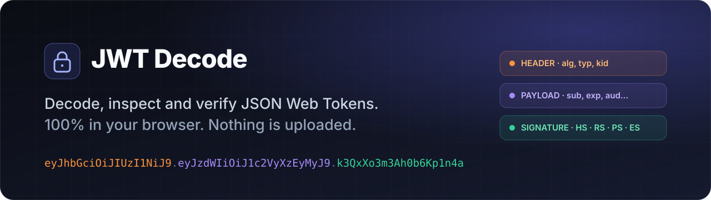
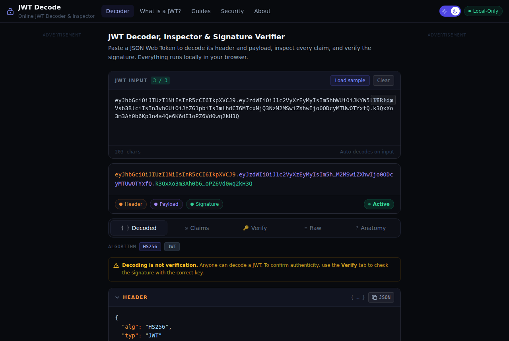
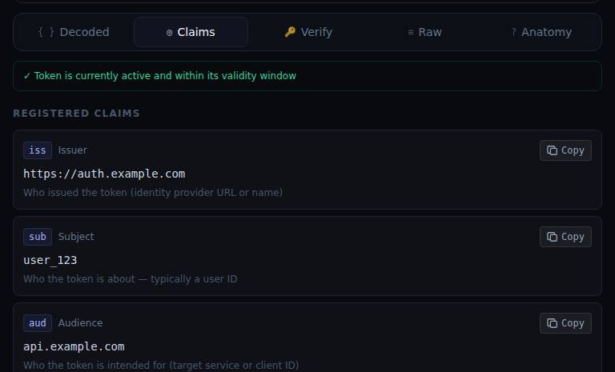
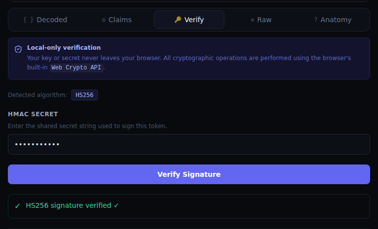
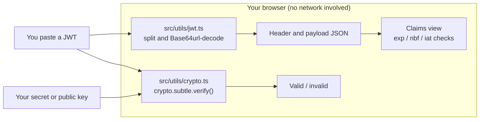
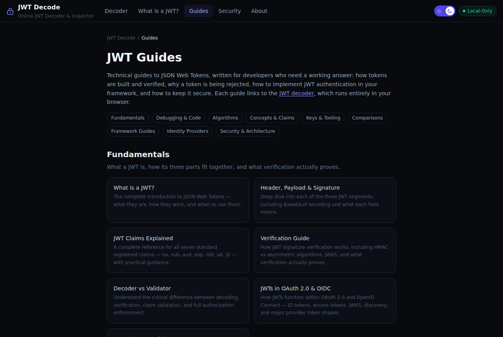
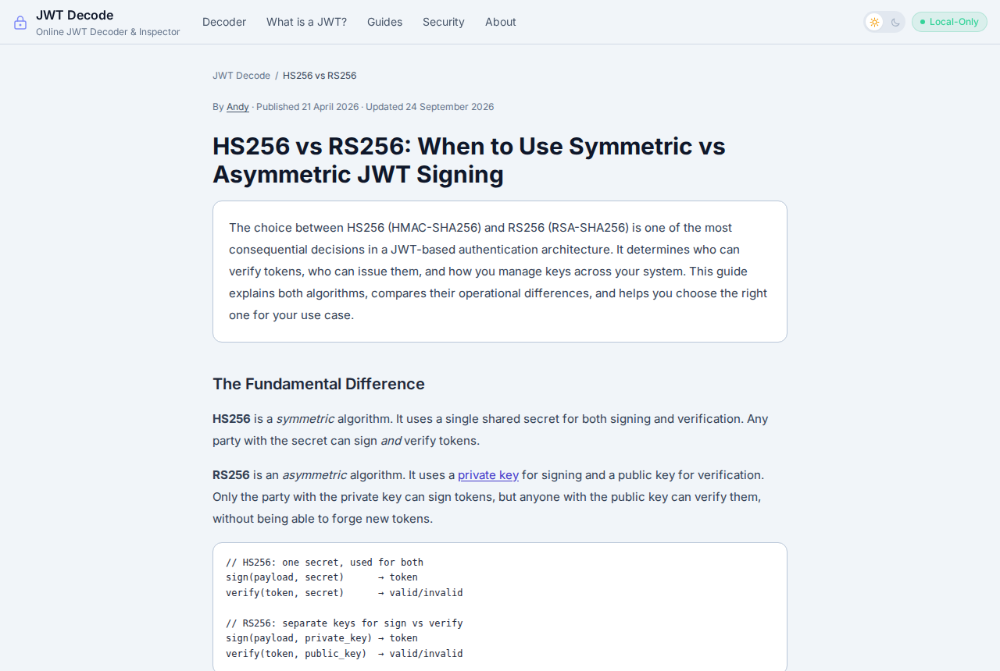

<div align="center">

<a href="https://jwtdecode.app"></a>

<h3>
  <a href="https://jwtdecode.app">Open the decoder</a>
  <span> · </span>
  <a href="https://jwtdecode.app/guides">Read the guides</a>
  <span> · </span>
  <a href="https://jwtdecode.app/how-it-works">How it works</a>
</h3>

[](https://jwtdecode.app) [](LICENSE) [](#-verify-it-yourself) [](#-the-jwt-guide-library)
<br>
    

</div>

**JWT Decode** is a free, private JWT decoder, inspector and signature verifier. Paste a JSON Web Token to see its header and payload, read every claim with human-readable timestamps, and check the signature with your secret or public key. Everything runs locally in your browser: the token and your keys are never sent to a server.

<picture>
  <source media="(prefers-color-scheme: dark)" srcset="docs/screenshot-dark.png">
  <source media="(prefers-color-scheme: light)" srcset="docs/screenshot-light.png">
  
</picture>

## ✨ Highlights

<table>
<tr>
<td width="33%" valign="top">

**⚡ Instant decode**<br>
<sub>Decodes as you type. Header, payload and signature are colour-coded, with syntax-highlighted JSON and one-click copy.</sub>

</td>
<td width="33%" valign="top">

**🕐 Claims you can read**<br>
<sub>Each registered claim (`iss` `sub` `aud` `exp` `nbf` `iat` `jti`) is explained, with absolute and relative times and an active, expired or not-yet-valid badge.</sub>

</td>
<td width="33%" valign="top">

**✅ Real signature checks**<br>
<sub>Verifies HMAC, RSA, RSA-PSS and ECDSA signatures with the browser's own Web Crypto API.</sub>

</td>
</tr>
<tr>
<td width="33%" valign="top">

**🔒 Local only**<br>
<sub>No upload, no account and no token telemetry. Token state lives in memory and disappears when you close the tab.</sub>

</td>
<td width="33%" valign="top">

**🧬 Raw and anatomy views**<br>
<sub>See each Base64url segment exactly as it appears in the token, and how the three parts fit together.</sub>

</td>
<td width="33%" valign="top">

**📚 46 in-depth guides**<br>
<sub>From "what is a JWT?" to JWKS, key rotation, attacks and framework integration.</sub>

</td>
</tr>
</table>

<table>
<tr>
<td width="50%" align="center"><br><sub><b>Claims:</b> timestamps decoded and checked</sub></td>
<td width="50%" align="center"><br><sub><b>Verify:</b> HS256 signature checked locally</sub></td>
</tr>
</table>

### Supported algorithms

| Family | Algorithms | Key you provide |
|:--|:--|:--|
| HMAC | `HS256` `HS384` `HS512` | Shared secret |
| RSA PKCS#1 v1.5 | `RS256` `RS384` `RS512` | RSA public key (PEM, SPKI) |
| RSA-PSS | `PS256` `PS384` `PS512` | RSA public key (PEM, SPKI) |
| ECDSA | `ES256` `ES384` `ES512` | EC public key (PEM, SPKI) |
| Unsecured | `none` | Flagged as unsigned, never "verified" |

Any JWS can be *decoded* whatever its algorithm. Encrypted JWE tokens (five segments) can't be decoded without the decryption key, so the decoder shows a parse error for them.

## 🔍 Verify it yourself

You don't have to take our word for it:

1. **Watch the network.** Open DevTools → Network, paste a token, and confirm no request carries it.
2. **Pull the plug.** Load the page, go offline, and keep decoding.
3. **Read the code.** Decoding is [`src/utils/jwt.ts`](src/utils/jwt.ts) and verification is [`src/utils/crypto.ts`](src/utils/crypto.ts). Neither makes a network call.



> [!NOTE]
> The hosted site at jwtdecode.app loads Google Analytics (page views only) and Google AdSense to pay for hosting. Neither script ever receives token contents. If you want zero third-party scripts, [run your own copy](#-run-it-yourself). It takes about a minute.

## 📚 The JWT guide library

**46 technical guides in 9 topics**, written for developers who need a working answer: how tokens are built and verified, why one is being rejected, how to add JWT authentication to your framework, and how to keep it secure. Each guide is a prerendered React page in [`src/pages/guides`](src/pages/guides), registered in [`src/guides.ts`](src/guides.ts). ⭐ marks the best place to start.

<table>
<tr>
<td width="50%" align="center"><a href="https://jwtdecode.app/guides"></a><br><sub><b>Guides hub</b>, grouped by topic</sub></td>
<td width="50%" align="center"><a href="https://jwtdecode.app/hs256-vs-rs256"></a><br><sub><b>Article layout</b> in light mode (dark mode follows your OS)</sub></td>
</tr>
</table>

<table>
<tr>
<td width="33%" valign="top"><a href="#-fundamentals"><b>📘 Fundamentals</b></a><br><sub>7 guides · What a JWT is, how its three parts fit together, and what verification actually proves.</sub></td>
<td width="33%" valign="top"><a href="#-debugging--code"><b>🔧 Debugging & Code</b></a><br><sub>3 guides · Fix the token that is being rejected, and decode or verify JWTs in real code.</sub></td>
<td width="33%" valign="top"><a href="#-algorithms"><b>🔐 Algorithms</b></a><br><sub>4 guides · HS256, RS256, PS256, ES256 and the none-algorithm trap.</sub></td>
</tr>
<tr>
<td width="33%" valign="top"><a href="#-concepts--claims"><b>📋 Concepts & Claims</b></a><br><sub>5 guides · Claims, key IDs, key sets, scopes and roles.</sub></td>
<td width="33%" valign="top"><a href="#-keys--tooling"><b>🗝️ Keys & Tooling</b></a><br><sub>5 guides · Generate secrets and key pairs, test from the command line, and keep tokens small.</sub></td>
<td width="33%" valign="top"><a href="#-comparisons"><b>⚖️ Comparisons</b></a><br><sub>7 guides · JWT against sessions, OAuth, SAML, API keys and other tools.</sub></td>
</tr>
<tr>
<td width="33%" valign="top"><a href="#-framework-guides"><b>🧩 Framework Guides</b></a><br><sub>6 guides · End-to-end JWT authentication in popular backend frameworks.</sub></td>
<td width="33%" valign="top"><a href="#-identity-providers"><b>🪪 Identity Providers</b></a><br><sub>2 guides · Validate tokens issued by Azure Entra ID and AWS Cognito.</sub></td>
<td width="33%" valign="top"><a href="#-security--architecture"><b>🛡️ Security & Architecture</b></a><br><sub>7 guides · Storage, refresh, revocation, attacks and microservice patterns.</sub></td>
</tr>
</table>

### 📘 Fundamentals

<sub>What a JWT is, how its three parts fit together, and what verification actually proves.</sub>

| Guide | What you will learn | Source |
|:--|:--|:--:|
| **[What is a JWT?](https://jwtdecode.app/what-is-a-jwt)** ⭐ | The complete introduction to JSON Web Tokens — what they are, how they work, and when to use them. | [`tsx`](pages/guides/WhatIsJwt.tsx) |
| **[Header, Payload & Signature](https://jwtdecode.app/jwt-header-payload-signature-explained)** | Deep dive into each of the three JWT segments, including Base64url encoding and what each field means. | [`tsx`](pages/guides/HeaderPayloadSignature.tsx) |
| **[JWT Claims Explained](https://jwtdecode.app/jwt-claims-explained)** ⭐ | A complete reference for all seven standard registered claims — iss, sub, aud, exp, nbf, iat, jti — with practical guidance. | [`tsx`](pages/guides/ClaimsExplained.tsx) |
| **[Verification Guide](https://jwtdecode.app/jwt-verification-guide)** ⭐ | How JWT signature verification works, including HMAC vs asymmetric algorithms, JWKS, and what verification actually proves. | [`tsx`](pages/guides/VerificationGuide.tsx) |
| **[Decoder vs Validator](https://jwtdecode.app/jwt-decoder-vs-jwt-validator)** | Understand the critical difference between decoding, verification, claim validation, and full authorization enforcement. | [`tsx`](pages/guides/DecoderVsValidator.tsx) |
| **[JWTs in OAuth 2.0 & OIDC](https://jwtdecode.app/jwt-in-oauth2-and-openid-connect)** | How JWTs function within OAuth 2.0 and OpenID Connect — ID tokens, access tokens, JWKS, discovery, and major provider token shapes. | [`tsx`](pages/guides/JwtInOauth2AndOidc.tsx) |
| **[Decode a JWT Without a Server](https://jwtdecode.app/decode-jwt-without-a-server)** ⭐ | How to decode and verify a JWT entirely in your browser via the Web Crypto API — no upload, no telemetry. The privacy-first way to inspect production tokens. | [`tsx`](pages/guides/DecodeJwtWithoutAServer.tsx) |

### 🔧 Debugging & Code

<sub>Fix the token that is being rejected, and decode or verify JWTs in real code.</sub>

| Guide | What you will learn | Source |
|:--|:--|:--:|
| **[Common JWT Errors & Fixes](https://jwtdecode.app/common-jwt-errors-and-fixes)** ⭐ | Fix malformed tokens, invalid signatures, expired tokens, wrong audience/issuer errors, and clock skew issues. | [`tsx`](pages/guides/CommonErrors.tsx) |
| **[Decode & Verify JWT in Code](https://jwtdecode.app/how-to-decode-jwt-in-javascript-python-go)** | Working code examples for decoding and verifying JWTs in JavaScript, Python, and Go — from raw Base64url to production-ready verification. | [`tsx`](pages/guides/DecodeJwtInCode.tsx) |
| **[How to Debug a JWT](https://jwtdecode.app/how-to-debug-a-jwt)** ⭐ | A step-by-step routine for 401 and 403 errors: capture the real token, check alg, kid, exp, iss and aud, then verify the signature. | [`tsx`](pages/guides/HowToDebugAJwt.tsx) |

### 🔐 Algorithms

<sub>HS256, RS256, PS256, ES256 and the none-algorithm trap.</sub>

| Guide | What you will learn | Source |
|:--|:--|:--:|
| **[HS256 vs RS256](https://jwtdecode.app/hs256-vs-rs256)** ⭐ | When to use a shared secret vs a public/private key pair, and how the choice affects your security architecture. | [`tsx`](pages/guides/Hs256VsRs256.tsx) |
| **[ES256 Explained](https://jwtdecode.app/es256-explained)** | ECDSA with P-256 and SHA-256 — the modern asymmetric JWT algorithm. Signature format, key sizes, and why it beats RS256 for greenfield systems. | [`tsx`](pages/guides/Es256Explained.tsx) |
| **[PS256 vs RS256](https://jwtdecode.app/ps256-vs-rs256)** | RSA-PSS padding versus PKCS#1 v1.5 — same key pair, different security properties. Migration guidance and the algorithm-confusion pitfall both share. | [`tsx`](pages/guides/Ps256VsRs256.tsx) |
| **[The "none" Algorithm Vulnerability](https://jwtdecode.app/none-algorithm-vulnerability)** | The 2015 JWT none-algorithm attack: how libraries shipped vulnerable defaults, the confusion variant that followed, and the universal defence every verifier must apply. | [`tsx`](pages/guides/NoneAlgorithmVulnerability.tsx) |

### 📋 Concepts & Claims

<sub>Claims, key IDs, key sets, scopes and roles.</sub>

| Guide | What you will learn | Source |
|:--|:--|:--:|
| **[What Is JWKS?](https://jwtdecode.app/what-is-jwks)** | JSON Web Key Sets explained: JWK fields, jwks_uri discovery, caching, rotation, JWK-to-PEM and verification code. | [`tsx`](pages/guides/WhatIsJwks.tsx) |
| **[JWT Scopes vs Roles](https://jwtdecode.app/jwt-scopes-vs-roles)** | Scopes vs roles in JWTs: the scope and scp claims, roles and permissions claims by provider, naming conventions and RBAC design. | [`tsx`](pages/guides/JwtScopesVsRoles.tsx) |
| **[The JWT kid Header](https://jwtdecode.app/jwt-kid-header)** | What the kid key ID means, why it is a header not a claim, value formats, JWKS lookup, key rotation and kid injection defences. | [`tsx`](pages/guides/JwtKidHeader.tsx) |
| **[JWT Expiration Time](https://jwtdecode.app/jwt-expiration-time)** | The exp, iat and nbf claims, seconds vs milliseconds, expiresIn units by library, OAuth expires_in, lifetimes, plus a timestamp converter. | [`tsx`](pages/guides/JwtExpirationTime.tsx) |
| **[JWT aud Claim](https://jwtdecode.app/jwt-audience-claim)** | What the audience claim means, string vs array values, aud vs sub, iss and azp, audience validation in code and fixing invalid audience. | [`tsx`](pages/guides/JwtAudienceClaim.tsx) |

### 🗝️ Keys & Tooling

<sub>Generate secrets and key pairs, test from the command line, and keep tokens small.</sub>

| Guide | What you will learn | Source |
|:--|:--|:--:|
| **[JWT Size Limit](https://jwtdecode.app/jwt-size-limit)** | No size limit in RFC 7519, but nginx, Apache, Node.js, AWS and cookies impose one. Calculate token size and shrink it. | [`tsx`](pages/guides/JwtSizeLimit.tsx) |
| **[JWT Secret Key Generator](https://jwtdecode.app/jwt-secret-key-generator)** | Generate a random HS256, HS384 or HS512 secret in your browser, and learn the RFC 7518 minimum size and CLI commands. | [`tsx`](pages/guides/JwtSecretKeyGenerator.tsx) |
| **[JWT With curl and Postman](https://jwtdecode.app/jwt-curl-postman)** | Send a JWT bearer token with curl or --oauth2-bearer, set up Postman Bearer Token and JWT Bearer auth, and fix 401s. | [`tsx`](pages/guides/JwtCurlPostman.tsx) |
| **[Generate JWT Signing Keys With OpenSSL](https://jwtdecode.app/generate-jwt-signing-keys-openssl)** | OpenSSL commands for RS256, ES256 and Ed25519 key pairs, PKCS#1 vs PKCS#8 conversion, and a Node.js sign-and-verify test. | [`tsx`](pages/guides/GenerateJwtSigningKeys.tsx) |
| **[Decode JWT From the Command Line](https://jwtdecode.app/decode-jwt-command-line)** | Tested bash, jq, PowerShell and Python one-liners that handle base64url padding, plus the jwt-cli and step CLI tools. | [`tsx`](pages/guides/DecodeJwtCommandLine.tsx) |

### ⚖️ Comparisons

<sub>JWT against sessions, OAuth, SAML, API keys and other tools.</sub>

| Guide | What you will learn | Source |
|:--|:--|:--:|
| **[JWT vs Session Tokens](https://jwtdecode.app/jwt-vs-session-tokens)** | How to choose between stateless JWTs and server-side sessions — revocation, scaling, storage, and the hybrid approach. | [`tsx`](pages/guides/JwtVsSessionTokens.tsx) |
| **[jwt.io Alternative](https://jwtdecode.app/jwt-io-alternative)** | A factual comparison of jwtdecode.app and jwt.io: what is the same, what differs, and when each is the better tool. | [`tsx`](pages/guides/JwtIoAlternative.tsx) |
| **[JWT vs SAML](https://jwtdecode.app/jwt-vs-saml)** | SAML XML assertions versus JWT and OpenID Connect ID tokens for single sign-on: format, signatures, flows and where each is used. | [`tsx`](pages/guides/JwtVsSaml.tsx) |
| **[JWT vs OAuth](https://jwtdecode.app/jwt-vs-oauth)** | Why OAuth is an authorisation framework and JWT a token format, plus JWT vs opaque access tokens and introspection. | [`tsx`](pages/guides/JwtVsOauth.tsx) |
| **[JWT vs Bearer Token](https://jwtdecode.app/jwt-vs-bearer-token)** | Bearer describes how a token is used, JWT what it contains: Bearer auth, RFC 6750 errors, the JWT bearer grant and DPoP. | [`tsx`](pages/guides/JwtVsBearerToken.tsx) |
| **[JWT vs API Key](https://jwtdecode.app/jwt-vs-api-key)** | Static API keys versus short-lived signed JWTs: revocation, validation cost, security, and exchanging a key for a JWT. | [`tsx`](pages/guides/JwtVsApiKey.tsx) |
| **[Is a JWT Encrypted? JWS vs JWE](https://jwtdecode.app/is-jwt-encrypted-jws-vs-jwe)** | Why most JWTs are signed not encrypted, how JWE's five parts and alg/enc work, and when a nested signed-then-encrypted JWT fits. | [`tsx`](pages/guides/IsJwtEncrypted.tsx) |

### 🧩 Framework Guides

<sub>End-to-end JWT authentication in popular backend frameworks.</sub>

| Guide | What you will learn | Source |
|:--|:--|:--:|
| **[JWT Authentication in Spring Boot](https://jwtdecode.app/jwt-authentication-spring-boot)** | Spring Security's OAuth2 Resource Server for Boot 4 and 3: starter, issuer-uri, role mapping, NimbusJwtEncoder and jjwt. | [`tsx`](pages/guides/JwtAuthSpringBoot.tsx) |
| **[JWT Authentication in Node.js & Express](https://jwtdecode.app/jwt-authentication-nodejs-express)** | Sign and verify JWTs with jsonwebtoken or jose, write Express auth middleware, and validate RS256 tokens via JWKS. | [`tsx`](pages/guides/JwtAuthNodeExpress.tsx) |
| **[JWT Authentication in Next.js](https://jwtdecode.app/jwt-authentication-nextjs)** | App Router JWT auth with jose: HttpOnly cookies via cookies(), proxy.ts (formerly middleware.ts), route handlers and server actions. | [`tsx`](pages/guides/JwtAuthNextjs.tsx) |
| **[JWT Authentication in FastAPI](https://jwtdecode.app/jwt-authentication-fastapi)** | FastAPI JWT auth with PyJWT, Argon2 via pwdlib and OAuth2PasswordBearer, plus JWKS verification and WebSocket tokens. | [`tsx`](pages/guides/JwtAuthFastapi.tsx) |
| **[JWT Authentication in Django REST Framework](https://jwtdecode.app/jwt-authentication-django)** | Simple JWT setup for DRF: settings, token URLs, refresh rotation, blacklist logout, React clients and Django Ninja. | [`tsx`](pages/guides/JwtAuthDjango.tsx) |
| **[JWT Authentication in ASP.NET Core](https://jwtdecode.app/jwt-authentication-aspnet-core)** | AddJwtBearer for .NET 8 to 10 Web APIs: validation parameters, roles and MapInboundClaims, dotnet user-jwts, refresh and logout. | [`tsx`](pages/guides/JwtAuthAspNetCore.tsx) |

### 🪪 Identity Providers

<sub>Validate tokens issued by Azure Entra ID and AWS Cognito.</sub>

| Guide | What you will learn | Source |
|:--|:--|:--:|
| **[Validate Azure Entra ID JWTs](https://jwtdecode.app/validate-azure-entra-id-jwt)** | Validate Azure AD / Entra ID access tokens: v1 vs v2 issuers, aud, oid vs sub, scp vs roles, JWKS discovery and APIM policies. | [`tsx`](pages/guides/ValidateEntraIdJwt.tsx) |
| **[Validate AWS Cognito JWTs](https://jwtdecode.app/validate-aws-cognito-jwt)** | Verify Cognito ID and access tokens: JWKS URL, issuer formats, token_use, aud vs client_id, aws-jwt-verify and API Gateway. | [`tsx`](pages/guides/ValidateCognitoJwt.tsx) |

### 🛡️ Security & Architecture

<sub>Storage, refresh, revocation, attacks and microservice patterns.</sub>

| Guide | What you will learn | Source |
|:--|:--|:--:|
| **[Security Best Practices](https://jwtdecode.app/jwt-security-best-practices)** ⭐ | Token lifetime, storage, audience/issuer validation, key rotation, algorithm confusion attacks, and common implementation mistakes. | [`tsx`](pages/guides/SecurityBestPractices.tsx) |
| **[JWT Storage: localStorage vs Cookie](https://jwtdecode.app/jwt-storage-localstorage-vs-cookie)** | localStorage, sessionStorage, HttpOnly cookies, in-memory variables — the XSS and CSRF tradeoffs of each, and the hybrid pattern most modern apps end up with. | [`tsx`](pages/guides/JwtStorageLocalstorageVsCookie.tsx) |
| **[Refresh Token Pattern](https://jwtdecode.app/jwt-refresh-token-pattern)** | Short-lived access tokens plus long-lived refresh tokens — rotation, replay detection, family revocation, and the implementation pitfalls that break the flow. | [`tsx`](pages/guides/JwtRefreshTokenPattern.tsx) |
| **[WebSocket JWT Authentication](https://jwtdecode.app/jwt-websocket-authentication)** | Authenticating a WebSocket with a JWT when the browser can't set headers: cookies, first message, subprotocol trick and ticket exchange. | [`tsx`](pages/guides/JwtWebsocketAuth.tsx) |
| **[JWT Logout & Revocation](https://jwtdecode.app/jwt-logout-and-revocation)** | How to invalidate a JWT before it expires: short access tokens, revocable refresh tokens, a Redis jti denylist and token versioning. | [`tsx`](pages/guides/JwtLogoutRevocation.tsx) |
| **[JWT in Microservices](https://jwtdecode.app/jwt-in-microservices)** | Gateway vs per-service validation, token propagation vs RFC 8693 exchange, mTLS/SPIFFE, per-service audiences and JWKS caching. | [`tsx`](pages/guides/JwtMicroservices.tsx) |
| **[JWT Attacks & Vulnerabilities](https://jwtdecode.app/jwt-attacks-and-vulnerabilities)** | alg none, algorithm confusion, weak secrets, kid/jku injection, psychic signatures and token leakage, with a test and a fix for each. | [`tsx`](pages/guides/JwtAttacks.tsx) |

## 🚀 Run it yourself

**Requirements:** Node.js 20 or newer.

```bash
git clone https://github.com/jwtdecode/jwt-decoder.git
cd jwt-decoder
npm ci
npm run dev          # http://localhost:5173
```

Production build: a client bundle, an SSR bundle, then a static prerender of every route into `dist/`.

```bash
npm run build
npx vite preview     # serve dist/ locally
```

<details>
<summary><b>🐳 Docker (nginx serving the prerendered build)</b></summary>

```bash
docker build --target production -t jwt-decoder .
docker run --rm -p 8080:80 \
  -v "$PWD/nginx/conf.d/jwtdecode-internal.conf:/etc/nginx/conf.d/jwtdecode.conf:ro" \
  jwt-decoder
# http://localhost:8080
```

The mounted config is the plain-HTTP server block used behind a TLS-terminating proxy. `nginx/conf.d/jwtdecode.conf` is the standalone HTTPS variant.

</details>

## 🗂️ Project structure

```text
src/
├── App.tsx                 routes and homepage
├── entry-client.tsx        browser hydration
├── entry-server.tsx        SSR entry used by the prerenderer
├── guides.ts               guide registry (hub, grid, footer, breadcrumbs)
├── components/             decoder UI, claims, verify, article layout, SEO head
├── pages/guides/           the 46 guide pages
├── pages/trust/            about, how it works, privacy, terms, contact
└── utils/
    ├── jwt.ts              parsing and Base64url decoding
    └── crypto.ts           Web Crypto signature verification
prerender.mjs               renders every route to static HTML
nginx/                      production nginx configs (headers, caching, redirects)
```

**Stack:** React 18, TypeScript, Vite, Tailwind CSS, react-router and react-helmet-async. Every route is prerendered to static HTML, so pages paint fast and are fully crawlable. Inter and JetBrains Mono are self-hosted via Fontsource, so no third-party font requests are made.

## 🤝 Contributing

Issues and pull requests are welcome. The most useful are tokens that decode or verify incorrectly, and corrections to the guides.

- Never paste a real production token or private key into an issue. Generate a test token instead.
- To add a guide, create a page in `src/pages/guides/`, register it in `src/guides.ts`, add its route in `src/App.tsx`, and run `npm run build` to confirm it prerenders.

## 🔐 Security

Please report vulnerabilities privately, as described in [`/.well-known/security.txt`](public/.well-known/security.txt), rather than in a public issue.

## 📄 License

[MIT](LICENSE) © Andy, [jwtdecode.app](https://jwtdecode.app)

<div align="center"><sub>If this saved you a debugging session, a ⭐ helps other developers find it.</sub></div>
